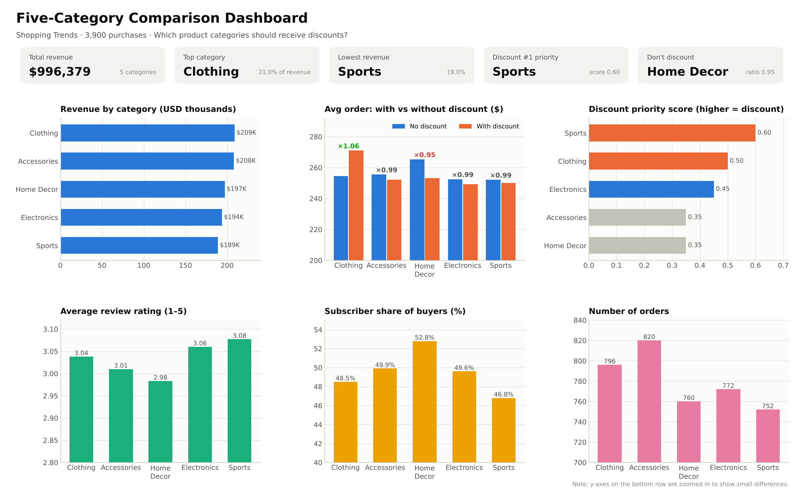
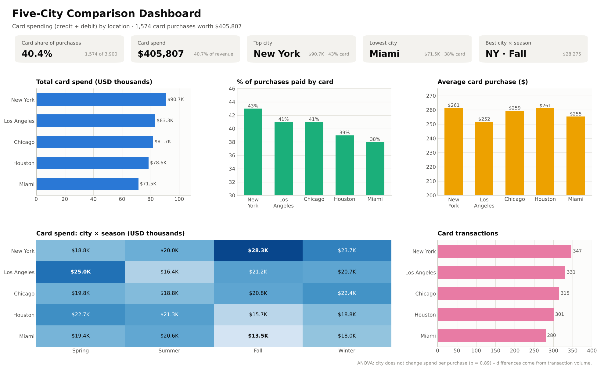
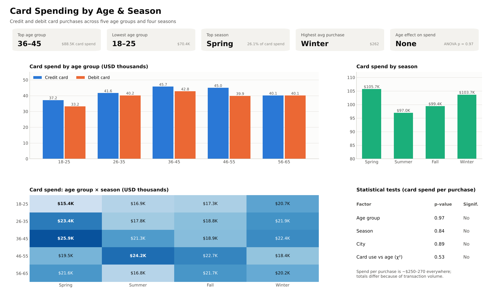
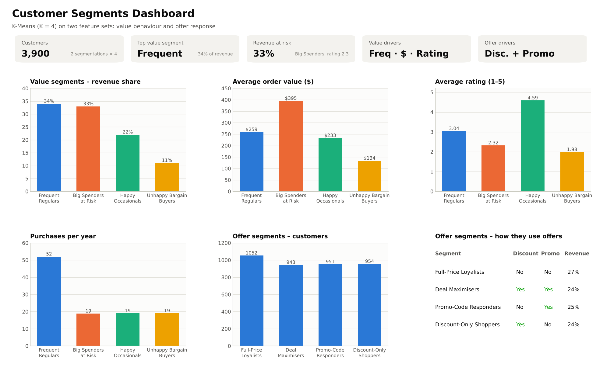

# Customer Segmentation of U.S. Shoppers (CDACL-002)

Analysis of 3,900 shopping transactions to decide **where to apply discounts**, understand **card spending by age, season and location**, and **cluster customers** into segments for targeted marketing campaigns.

## Key findings

| Question | Finding |
|---|---|
| Which categories should get discounts? | **Sports** (lowest revenue and loyalty, highest rating) and **Clothing** as bundle offers (+6.5% basket with discount). **Don't discount Home Decor** (basket shrinks 5%). |
| Card spending by age, season and location | 40.4% of purchases are paid by card. Spend per purchase is the same everywhere (ANOVA p > 0.8); volume peaks with **36–45 year olds**, in **Spring** and in **New York**. |
| Customer segments (K-Means, K = 4) | **Frequent Regulars** (34% of revenue), **Big Spenders at Risk** (33%, rating 2.3), **Happy Occasionals** (22%), **Unhappy Bargain Buyers** (11%). A second clustering splits customers by offer response (discount and promo-code use). |

## Repository contents

| File | Description |
|---|---|
| `customer_segmentation.ipynb` | Google Colab notebook: data loading, cleaning, Task 1–3 analysis, clustering |
| `Customer_Segmentation_Presentation.pptx` | Presentation (with speaker notes) |
| `Customer_Segmentation_Report.docx` | Insights and analytics report |
| `dashboards/` | Dashboard images: five-category comparison, five-city comparison, card spend by age & season, customer segments |
| `customer_clustering.ows` | Orange workflow for K-Means clustering |

## Dashboards

## Method

1. Load data from MySQL with SQLAlchemy + PyMySQL (credentials are entered at run time, not stored).
2. Standardise columns, check missing values and duplicates.
3. Category comparison and a discount priority score (Task 1).
4. Card spend aggregation with ANOVA, Kruskal-Wallis and chi-square tests (Task 2).
5. Standardised K-Means (elbow + silhouette), Random-Forest feature importance, segment profiles and campaigns (Task 3).

## Tools

Python · pandas · NumPy · scikit-learn · SciPy · matplotlib · seaborn · SQLAlchemy · Google Colab · Orange

## How to run

Open `customer_segmentation.ipynb` in Google Colab and run all cells. Enter the MySQL host, user and password when prompted.
